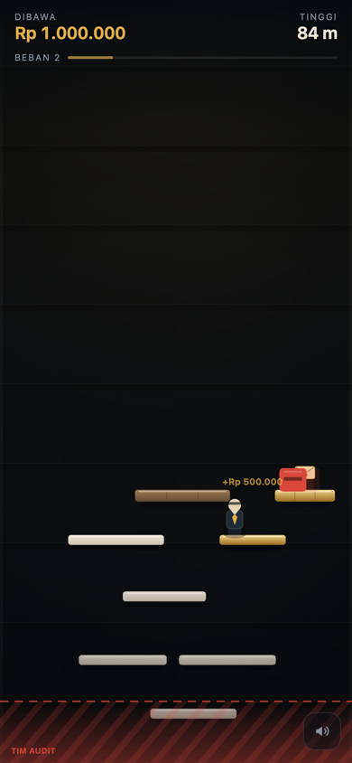
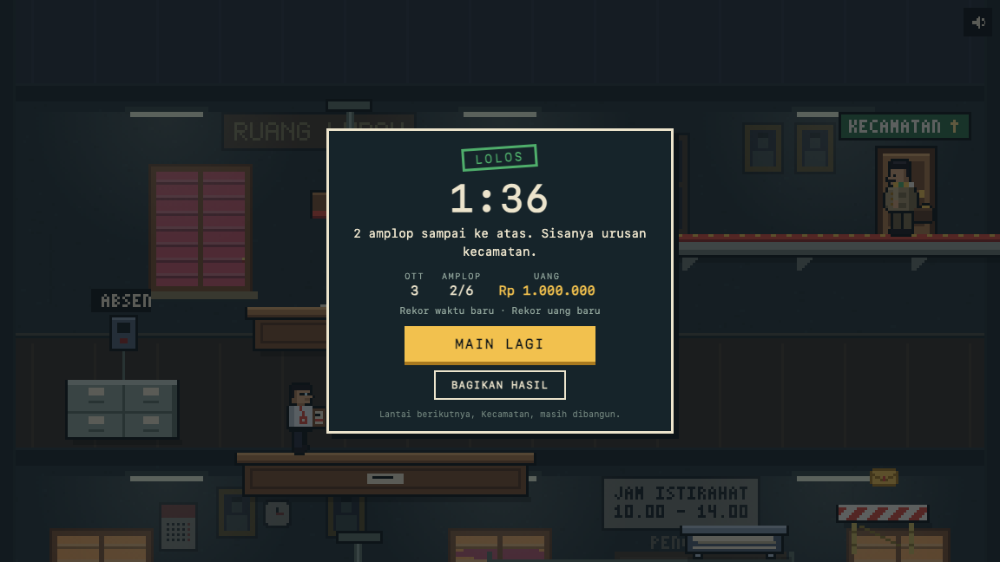

# Korupsi

A pixel-art browser platformer about climbing a bureaucracy, one office at a time, with
the audit team already in the lobby.

**[Play it at korupsi.web.id →](https://korupsi.web.id)**

[](https://github.com/XNyetok/korupsi/actions/workflows/ci.yml)
[](LICENSE)

| Gameplay | Result |
| --- | --- |
|  |  |

## How it plays

You are an official in a safari suit and a peci, and the only way out is up. The tower is
built by hand: every ledge, auditor and stamp is in the same place on every run, so a
death is something to learn from, not bad luck. The first floor, the Kelurahan, is
playable; the Kecamatan and the floors above it are next.

- **Run, jump, and *ngeles*.** Ngeles is a short dash. It crosses a gap that is too wide
  to jump, and it slips straight through an auditor.
- **Envelopes are money, and weight.** Each one is Rp 500.000 on the result card and 2%
  off your jump. The route is always possible with a full bag; it is just tighter.
- **Auditors and stamps mean OTT.** Caught, you go back to the last clock-in machine
  (*mesin absen*), and whatever you picked up since then is back where it was.
- **Do not fall far.** Once you have clocked in, the audit team tapes off the floors
  below. Drop past the tape and they have you.
- **Proyek fiktif** ledges, the red-and-white ones, give way shortly after you land.

The floor ends at the door to the Kecamatan. The result card shows your time, how often
you were caught, and what you carried out. "Bagikan hasil" turns that into a picture the
size of a story: a phone opens its share sheet with it, a computer saves the file.

| Input | Action |
| --- | --- |
| `←` `→` or `A` `D` | Run |
| `Space`, `↑`, `W` or `Z` | Jump (hold for a higher jump) |
| `Shift`, `X` or `K` | Ngeles (dash) |
| `Esc` or `P` | Pause |
| Touch | A left-right pad and two buttons appear on phones and tablets |

Switching apps pauses the run. On a phone the game fills the screen, held either way:
upright it shows a tall slice of the tower and the camera follows you sideways. Where the
browser has a full screen there is a button for it in the corner; on an iPhone, add the
page to the home screen and open it from there.

## Under the hood

| | |
| --- | --- |
| Build size | about 27 KB gzipped, no runtime dependencies; CI enforces a 30 KB budget |
| Stack | TypeScript and Canvas 2D, bundled by Vite |
| Art | pixel art drawn in code, a tower 384 pixels wide, scaled up without smoothing; no image files |
| Audio | a tune and effects synthesised with WebAudio; no audio files |
| Caching | none beyond HTTP: every visit loads the live build |
| Hosting | nginx on a VPS; a published GitHub Release is deployed by GitHub Actions |

The simulation has no DOM and no randomness in it, so a run can be stepped in a test
without a browser. The tests climb the tower that way: they check that every ledge on the
route can be reached with an empty bag and with a full one, that no ledge can be skipped,
and that a careful player gets to the door with every hazard switched on.

## Development

```sh
npm install
npm run dev      # dev server with hot reload
npm run check    # types only
npm run lint     # lint and format check (npm run format fixes the format)
npm test         # simulation tests, no browser needed
npm run test:e2e # browser smoke tests (once: npx playwright install chromium)
npm run build    # production build in dist/
npm run size     # gzipped size of the build against its budget
```

Add `?debug=1` to the URL for live sliders over jump velocity, gravity, run and dash
speed, and the weight of an envelope. It also puts the running game on `window.__korupsi`:
`__korupsi.placeOn(12)` stands the player on ledge 12, and `__korupsi.hazards = false`
switches the auditors and stamps off while a jump is being tuned.

The tower lives in [`src/core/tower.ts`](src/core/tower.ts), the numbers in
[`src/core/params.ts`](src/core/params.ts), and everything that is drawn in
[`src/view/`](src/view/).

## Documentation

- [`docs/plan.md`](docs/plan.md) — what is done, what is next; the only work list
- [`docs/design/game-design.md`](docs/design/game-design.md) — rules, the numbers, the
  art direction, and why each decision was made
- [`docs/deploy.md`](docs/deploy.md) — server layout, releases, rollback, CI pipeline
- [`CONTRIBUTING.md`](CONTRIBUTING.md) — commit style and what will not be merged
- [`SECURITY.md`](SECURITY.md) — how to report a vulnerability, privately

## Notes

- The game's copy is Indonesian, because the thing it is poking at is Indonesian. Nobody
  real is in it: no faces, no agency logos, no state emblems.
- On an iPhone, the silent switch mutes the game: Safari treats Web Audio as ambient
  sound, so the ringer switch wins.
- Telemetry is anonymous and aggregate: a visit, a finished or abandoned run, a share, a
  JavaScript error. No cookies, no addresses, no identifiers; Do Not Track disables it;
  raw rows are deleted after 90 days. The dashboard is private, but the collector's code
  is in [`server/`](server/) like everything else.

## License

MIT. See [LICENSE](LICENSE).
